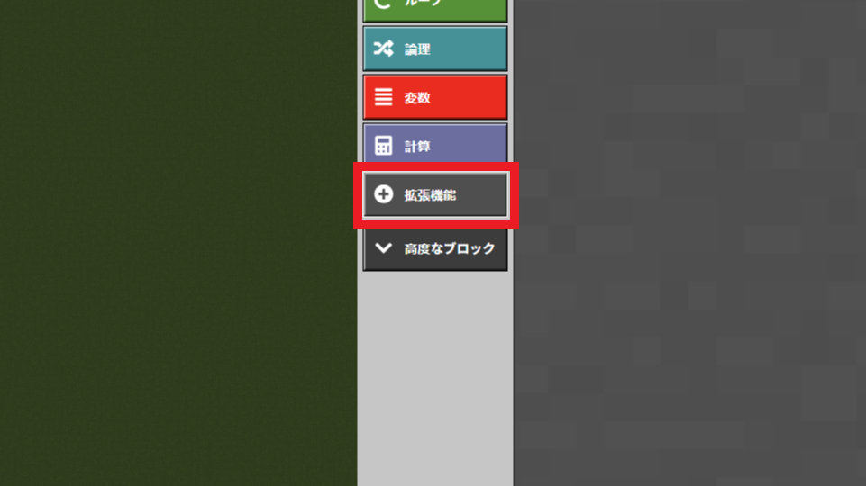
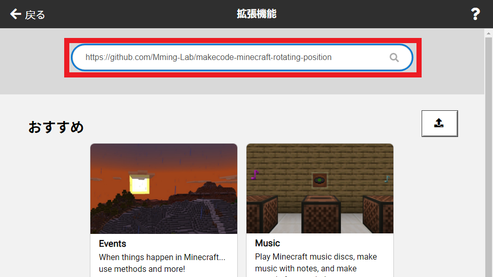
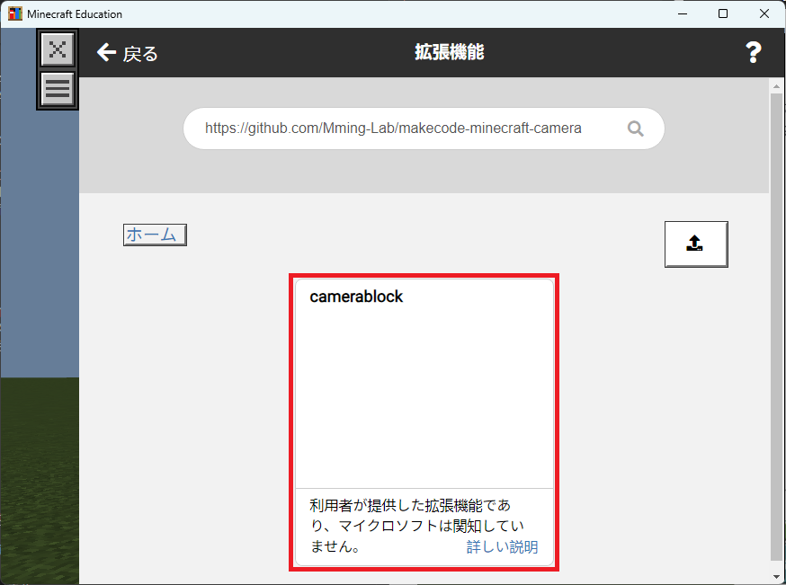

# Minecraft Education Edition用カメラブロック拡張機能

🌐 **言語**: [English](README.md) | [日本語](#日本語)

---

## 日本語

Minecraft Education Edition用のMakeCode拡張機能です。複雑なカメラコマンドを簡単なビジュアルブロックに変換して、映画のような動画やプレゼンテーションを作成できます！

## 🎬 デモ

<video width="640" height="360" controls>
  <source src="./camera_mccup.mp4" type="video/mp4">
  Your browser does not support the video tag.
</video>

[](https://mming-lab.github.io/makecode-minecraft-camera/)

*上記をクリックしてカメラブロックの動作を確認！*

**注**: このデモ動画では、[マインクラフトカップ](https://minecraftcup.com/)第6回大会たてもの部門の公式ワールドを使用させていただいています。マインクラフトカップは、世界中の子どもたちが教育版マインクラフトを使ってプログラミングや創造性を競う大会です。

## ✨ 機能

- **カメラプリセット**: 一人称・三人称・前面視点
- **スムーズな動き**: 28種類のイージングアニメーション
- **入力制御**: プレイヤーとカメラの操作を有効/無効
- **画面エフェクト**: カスタム色でのフェード効果
- **ビジュアルプログラミング**: 覚えるコマンドなし

## 📚 インストール方法

### 1. 拡張機能ボタンを押下

MakeCode for Minecraftのエディタ画面で、左下の**拡張機能**ボタンをクリックします。



### 2. リポジトリURLを入力して検索

検索欄に以下のURLを入力して検索します：

```
https://github.com/Mming-Lab/makecode-minecraft-camera
```



### 3. 拡張機能を取り込み

検索結果に表示された拡張機能を選択してインポートします。



## 📄 ライセンス

このプロジェクトは [PolyForm Noncommercial License 1.0.0](LICENSE) の下で公開されています。
非商用目的でのみ利用可能です。詳細は [LICENSE](LICENSE) をご確認ください。

---

*英語版のドキュメントは [README.md](README.md) をご覧ください*